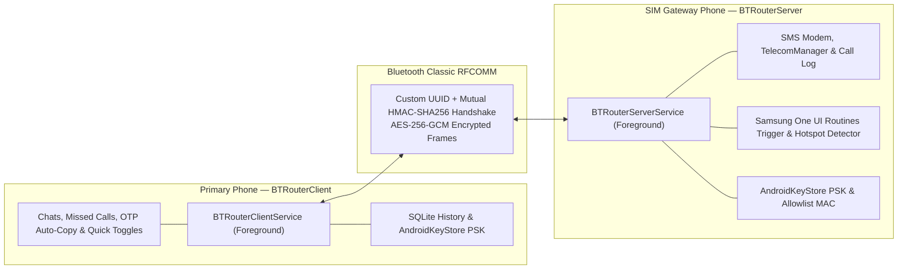

# BTRouter

[English](README.md) | [Русский](README.ru.md)

**BTRouter** is an Android dual-app system that turns a secondary SIM-holding Android phone (**Server**) into an encrypted Bluetooth Classic (RFCOMM) gateway for your primary Android phone (**Client**) — no internet connection, cloud relay, or third-party server required.

---

## Architecture



---

## Key Features

### `BTRouterClient` (`com.exantt.btrouterclient`)
- **Live Server Telemetry:** Displays Server connection status, battery percentage/charging state, cellular operator, signal strength (`0–4`), and mobile internet status inside the app and persistent foreground notification.
- **SMS Messenger UI:** Full chat-threaded SMS client backed by local SQLite storage (`btrouter_chats.db`) with unread counters, pin-to-top (up to 5 chats), archive/mute, message copy/delete, and offline SMS queuing (up to 20 messages, 30-minute TTL).
- **Smart OTP / 2FA Extraction:** Automatically extracts verification codes from English, Russian, and Turkish bank/service SMS (including inverted Turkish phrasing) while filtering out dates, card suffixes, monetary amounts, phone numbers, and carrier suffixes (`B001`, `M001`). Supports one-tap notification copy and optional clipboard auto-copy.
- **Call Monitoring & Actions:** Real-time incoming call banner and high-priority notification with remote **Decline**, missed-call notifications and persistent **Missed Calls** log with unread badge, plus remote outgoing **Dial** routed to Server.
- **Dual Address Book:** Switch between Client local contacts and Server contacts streamed in encrypted chunks over Bluetooth, plus recent SMS recipients.
- **Missed-Event Sync:** On-demand sync for the last 5 minutes (`SYNC_5MIN`) or all missed SMS/calls since the last disconnect (`SYNC_DISCONNECT`), deduplicated by `eventId`.
- **Optional Remote Toggles (Samsung One UI 5+):** Compact switches for Server **Mobile Data** and **Mobile Hotspot** powered by Samsung Modes & Routines notification triggers.
- **Bilingual Interface:** Built-in runtime language switcher (**English** / **Русский**).

### `BTRouterServer` (`com.exantt.btrouterserver`)
- **Persistent Gateway Service:** Runs as a `connectedDevice` foreground service with automatic start on boot (`BootReceiver`) and lock-free wakeups via Bluetooth state monitoring.
- **Serialized Outbound SMS Queue:** Dispatches single-part and multipart SMS (up to 10 parts) sequentially with inter-send cooldowns and per-message modem status feedback (`SMS_SENT`).
- **Reliable Delivery Buffer:** Persists up to 30 unacknowledged live SMS (24-hour TTL) and flushes them upon Client reconnection until `EVENT_ACK` is received.
- **Contacts & Telemetry Sync:** Streams up to 5,000 contacts in framed chunks and reports battery, cellular, network, hotspot (`HotspotDetector`), and mobile data (`ContentObserver`) state changes.
- **Strict Access Control:** Accepts connections exclusively from a single explicitly selected paired Bluetooth MAC address and verifies the 16-character pre-shared key on every session.

---

## Security Model

- **Dedicated Service UUID:** Uses custom RFCOMM UUID `7d4e9a2b-6c14-4f83-9b52-3e8a1d7c4f90` instead of the generic SPP UUID.
- **Fail-Closed MAC Allowlist:** Server rejects all incoming RFCOMM sockets unless the remote Bluetooth MAC matches the configured Client device, applying progressive backoff (up to 5 s) against unauthorized connection floods.
- **Mutual Authentication (PSK + HMAC-SHA256):** Both sides derive a master key (`SHA-256("BTRouter-PSK-v2:" + normalizedSecret)`) from the 16-character pairing key (`XXXX-XXXX-XXXX-XXXX`, minimum 12 characters) and exchange 16-byte `SecureRandom` nonces verified via constant-time `MessageDigest.isEqual`.
- **Authenticated Encryption (AES-256-GCM):** Derives directional session keys (`KEY-C2S`, `KEY-S2C`). Every frame uses a 12-byte nonce (`4-byte direction tag + 8-byte monotonic sequence number`) bound as AAD, blocking tampering, reordering, and replay attacks.
- **Hardware-Backed Key Storage:** Both apps wrap the pairing secret in `AndroidKeyStore` (`AES/GCM/NoPadding`, `btrouter_psk_wrap_key`) and set `android:allowBackup="false"` with `sharedpref` excluded from cloud backup and device transfers.
- **Release Hardening:** R8 code shrinking, resource shrinking, and ProGuard rules stripping `Log.v`, `Log.d`, and `Log.i` calls in release builds.

For vulnerability reporting and full threat-model notes, see [SECURITY.md](SECURITY.md).

---

## Requirements

- Two Android devices running **Android 10 (API 29) or higher** (tested against `targetSdk 36`).
- Classic Bluetooth enabled and both devices paired in Android system Bluetooth settings.
- On **Server**: Phone, Call Log, Contacts, SMS (`RECEIVE_SMS`, `READ_SMS`, `SEND_SMS`), Bluetooth, and Notifications permissions granted, plus **Unrestricted** battery optimization recommended for reliable background operation.
- On **Client**: Bluetooth, Notifications, and (optionally) Contacts permissions granted.

---

## Quick Setup & Pairing

1. Install **BTRouterServer** on the phone holding your SIM card and **BTRouterClient** on your primary phone.
2. Pair the two phones in **Android Settings → Bluetooth**.
3. Open **BTRouterServer**, grant all requested permissions, tap **Выбрать устройство Client**, and pick your primary phone.
4. Reveal or copy the **Pairing Key (PSK)** shown on Server (`XXXX-XXXX-XXXX-XXXX`).
5. Open **BTRouterClient → ⚙ Settings**, select the Server device from the dropdown, paste the Pairing Key, and tap **Save Gateway Settings**.
6. Wait a moment for the status badge to show `● ONLINE` (encrypted channel active).

### Optional: Samsung One UI 5+ Remote Toggles
If **Server** runs on a Samsung device with One UI 5+, you can toggle Mobile Data and Mobile Hotspot directly from Client:
1. On Server, open **Settings → Modes and Routines → Routines → `+`**.
2. Create four routines triggered by **"Notification received"** from app **`BTRouterServer`** with specific keywords:
   - `BTR_HOTSPOT_ON` → Mobile Hotspot **On** (set *"When routine ends"* to *"Don't reverse"*)
   - `BTR_HOTSPOT_OFF` → Mobile Hotspot **Off**
   - `BTR_MOBILE_DATA_ON` → Mobile data **On** (set *"When routine ends"* to *"Don't reverse"*)
   - `BTR_MOBILE_DATA_OFF` → Mobile data **Off**
3. Enable the corresponding toggles in **BTRouterClient → ⚙ Settings**.

---

## Building from Source

### Prerequisites
- **JDK 21** (e.g. Android Studio JBR or Temurin 21)
- **Android SDK** with `platforms;android-36.1` and `build-tools;36.1.0`

### Commands

```bash
# BTRouterClient
cd BTRouterClient
./gradlew testDebugUnitTest lintDebug assembleDebug

# BTRouterServer
cd ../BTRouterServer
./gradlew testDebugUnitTest lintDebug assembleDebug
```

On Windows PowerShell, set `JAVA_HOME` to a JDK 21 installation and use `.\gradlew.bat`.

For local signed release builds and publishing GitHub Releases via CI/CD, see [RELEASE.md](RELEASE.md).

---

## Project Structure

```text
BTRouter/
├── BTRouterClient/          # Primary-phone Android app (com.exantt.btrouterclient)
├── BTRouterServer/          # SIM-gateway Android app (com.exantt.btrouterserver)
├── .github/workflows/       # CI (test/lint/build) & automated signed Release workflows
├── keystore.properties.example
├── CHANGELOG.md
├── CONTRIBUTING.md
├── RELEASE.md
├── SECURITY.md
└── LICENSE
```

## License

This project is licensed under the [MIT License](LICENSE).
