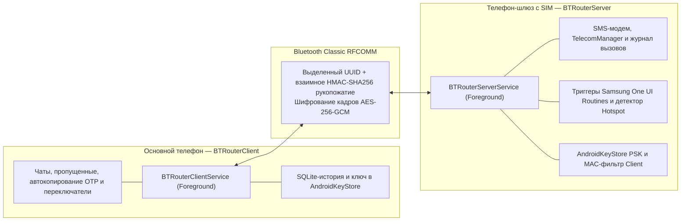

# BTRouter

[English](README.md) | [Русский](README.ru.md)

**BTRouter** — система из двух Android-приложений, превращающая второй смартфон с SIM-картой (**Server**) в зашифрованный Bluetooth Classic (RFCOMM) шлюз для вашего основного смартфона (**Client**) — без интернета, облачных сервисов и сторонних серверов.

---

## Архитектура



---

## Основные возможности

### `BTRouterClient` (`com.exantt.btrouterclient`)
- **Телеметрия Server в реальном времени:** отображает статус подключения, заряд батареи и состояние зарядки, сотового оператора, уровень сигнала (`0–4`) и статус мобильного интернета в приложении и в постоянном уведомлении.
- **SMS-мессенджер:** полноценный список диалогов на базе локальной базы SQLite (`btrouter_chats.db`) со счётчиками непрочитанных, закреплением до 5 чатов, архивацией с отключением уведомлений, удалением чатов/сообщений и очередью исходящих СМС без связи (до 20 сообщений, TTL 30 минут).
- **Умное извлечение OTP / 2FA-кодов:** распознаёт одноразовые коды в русских, английских и турецких банковских СМС (включая инвертированный турецкий синтаксис), отсеивая даты, номера карт, суммы, телефоны и коды операторов (`B001`, `M001`). Поддерживает кнопку копирования в уведомлении и опциональное автокопирование в буфер обмена.
- **Звонки и журнал пропущенных:** панель и приоритетное уведомление при входящем вызове на Server с кнопкой удалённого **сброса** (`DECLINE`), уведомления и экран **Пропущенные вызовы** с бейджем непросмотренных, а также удалённый запуск исходящего звонка на Server (`DIAL`).
- **Двойная адресная книга:** переключение между контактами Client и адресной книгой Server, передаваемой по зашифрованному каналу, плюс список недавних получателей СМС.
- **Синхронизация пропущенных событий:** догрузка СМС за последние 5 минут (`SYNC_5MIN`) или всех пропущенных СМС и звонков с момента обрыва (`SYNC_DISCONNECT`) с дедупликацией по `eventId`.
- **Быстрые переключатели (Samsung One UI 5+):** опциональные переключатели **Моб. данных** и **Точки доступа** Server прямо под строкой состояния через сценарии Samsung Modes & Routines.
- **Двуязычный интерфейс:** мгновенное переключение языка интерфейса (**Русский** / **English**) в настройках Client.

### `BTRouterServer` (`com.exantt.btrouterserver`)
- **Постоянный шлюз:** фоновая служба типа `connectedDevice` с автозапуском после перезагрузки (`BootReceiver`) и автоматическим восстановлением после переключений Bluetooth.
- **Сериализованная очередь исходящих СМС:** последовательно отправляет одно- и многосегментные СМС (до 10 частей) с паузами между отправками и точным отчётом модема по статусу доставки (`SMS_SENT`).
- **Надёжный буфер событий:** хранит до 30 неподтверждённых живых СМС (TTL 24 часа) и повторно доставляет их при переподключении Client до получения `EVENT_ACK`.
- **Передача контактов и телеметрии:** выгружает до 5000 контактов фрагментированными кадрами и отслеживает состояние батареи, сотовой сети, мобильных данных (`ContentObserver`) и точки доступа (`HotspotDetector`).
- **Жёсткий контроль доступа:** принимает соединения только с одного выбранного MAC-адреса спаренного устройства Client и проверяет 16-символьный ключ сопряжения при каждой сессии.

---

## Безопасность

- **Собственный UUID сервиса:** используется выделенный RFCOMM UUID `7d4e9a2b-6c14-4f83-9b52-3e8a1d7c4f90` вместо стандартного SPP.
- **Fail-closed MAC-фильтрация:** Server разрывает любые подключения не от разрешённого MAC-адреса и применяет нарастающую задержку (до 5 секунд) при спаме подключениями.
- **Взаимная аутентификация (PSK + HMAC-SHA256):** обе стороны формируют мастер-ключ `SHA-256("BTRouter-PSK-v2:" + normalizedSecret)` из ключа сопряжения (`XXXX-XXXX-XXXX-XXXX`, минимум 12 символов) и обмениваются 16-байтными nonce из `SecureRandom` со сверкой в постоянное время (`MessageDigest.isEqual`).
- **Шифрование AES-256-GCM:** после рукопожатия выводятся раздельные ключи `KEY-C2S` и `KEY-S2C`. Каждый кадр шифруется с 12-байтным nonce (`4 байта направления + 8-байтный монотонный счётчик`), привязанным как AAD, что защищает от подмены, перестановки и повторов кадров.
- **Хранение ключа в AndroidKeyStore:** секретный ключ сопряжения шифруется аппаратно-защищённым ключом (`btrouter_psk_wrap_key`); в манифестах задано `android:allowBackup="false"`, а `sharedpref` исключены из облачных бэкапов и переноса данных.
- **Защита release-сборки:** включены R8-минификация, сжатие ресурсов и удаление `Log.v` / `Log.d` / `Log.i` через ProGuard.

Подробнее об архитектуре защиты и правилах сообщения об уязвимостях — в [SECURITY.md](SECURITY.md).

---

## Требования

- Два устройства с **Android 10 (API 29) и выше** (`targetSdk 36`).
- Включённый Bluetooth Classic и предварительное системное сопряжение устройств.
- На **Server**: разрешения на телефон, журнал звонков, контакты, СМС (`RECEIVE_SMS`, `READ_SMS`, `SEND_SMS`), Bluetooth и уведомления, а также режим батареи **«Без ограничений»** для стабильной фоновой работы.
- На **Client**: разрешения на Bluetooth, уведомления и (по желанию) чтение контактов.

---

## Быстрая настройка и сопряжение

1. Установите **BTRouterServer** на телефон с SIM-картой, а **BTRouterClient** — на основной телефон.
2. Спарьте оба устройства в **Настройки Android → Bluetooth**.
3. Откройте **BTRouterServer**, выдайте запрошенные разрешения, нажмите **Выбрать устройство Client** и укажите ваш основной телефон.
4. Нажмите **Показать** или **Копир.** в блоке **Ключ сопряжения (PSK)** на Server.
5. Откройте **BTRouterClient → ⚙ Настройки**, выберите устройство Server, вставьте ключ сопряжения и нажмите **Сохранить настройки шлюза**.
6. Через пару секунд индикатор статуса перейдёт в состояние `● В СЕТИ` (зашифрованный канал активен).

### Дополнительно: управление точкой доступа и мобильным интернетом (Samsung One UI 5+)
Если **Server** запущен на смартфоне Samsung с One UI 5+:
1. На Server откройте **Настройки → Режимы и сценарии → вкладка «Сценарии» → `+`**.
2. Создайте четыре сценария с условием **«Уведомление получено»** от приложения **`BTRouterServer`** и ключевыми словами:
   - `BTR_HOTSPOT_ON` → Мобильная точка доступа **Вкл.** (в пункте *«Когда сценарий завершится»* выберите *«Ничего не делать»*)
   - `BTR_HOTSPOT_OFF` → Мобильная точка доступа **Выкл.**
   - `BTR_MOBILE_DATA_ON` → Мобильные данные **Вкл.** (отключите автовозврат)
   - `BTR_MOBILE_DATA_OFF` → Мобильные данные **Выкл.**
3. Включите нужные переключатели в **BTRouterClient → ⚙ Настройки**.

---

## Сборка из исходного кода

### Необходимые инструменты
- **JDK 21** (например, Android Studio JBR или Eclipse Temurin 21)
- **Android SDK**: `platforms;android-36.1` и `build-tools;36.1.0`

### Команды

```bash
# BTRouterClient
cd BTRouterClient
./gradlew testDebugUnitTest lintDebug assembleDebug

# BTRouterServer
cd ../BTRouterServer
./gradlew testDebugUnitTest lintDebug assembleDebug
```

В Windows PowerShell предварительно укажите `JAVA_HOME` на JDK 21 и используйте `.\gradlew.bat`.

Инструкция по локальной подписи APK и автоматической публикации релизов через GitHub Actions приведена в [RELEASE.md](RELEASE.md).

---

## Структура репозитория

```text
BTRouter/
├── BTRouterClient/          # Клиент для основного телефона (com.exantt.btrouterclient)
├── BTRouterServer/          # Шлюз для телефона с SIM (com.exantt.btrouterserver)
├── .github/workflows/       # CI (тесты, lint, сборка) и Release workflow
├── keystore.properties.example
├── CHANGELOG.md
├── CONTRIBUTING.md
├── RELEASE.md
├── SECURITY.md
└── LICENSE
```

## Лицензия

Проект распространяется под лицензией [MIT](LICENSE).
